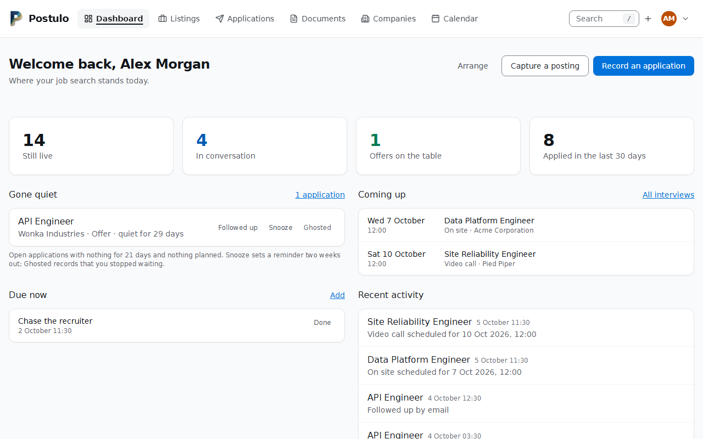
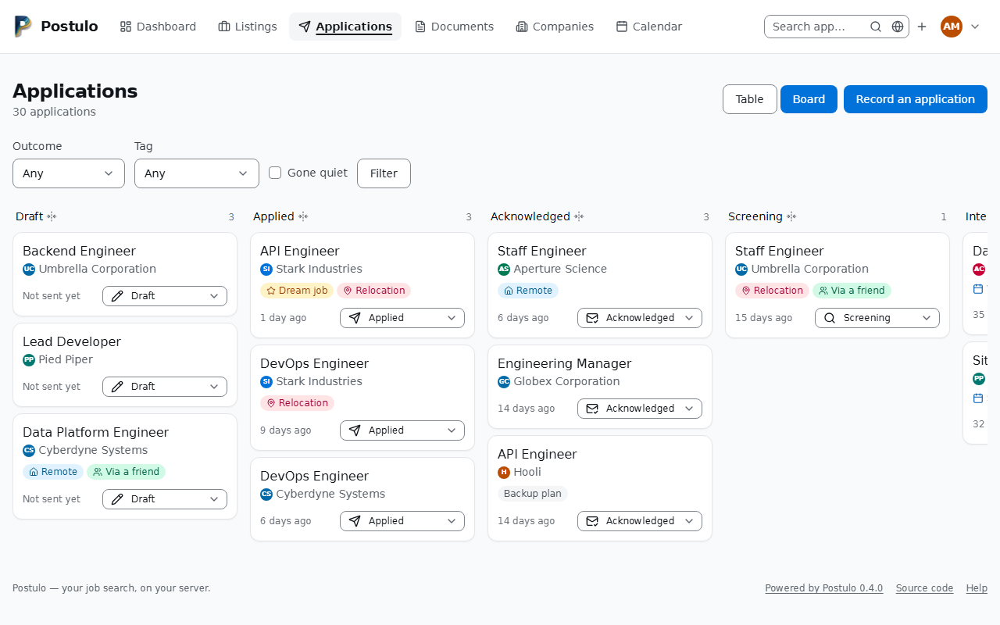
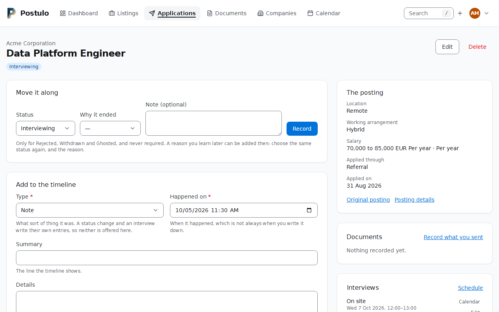
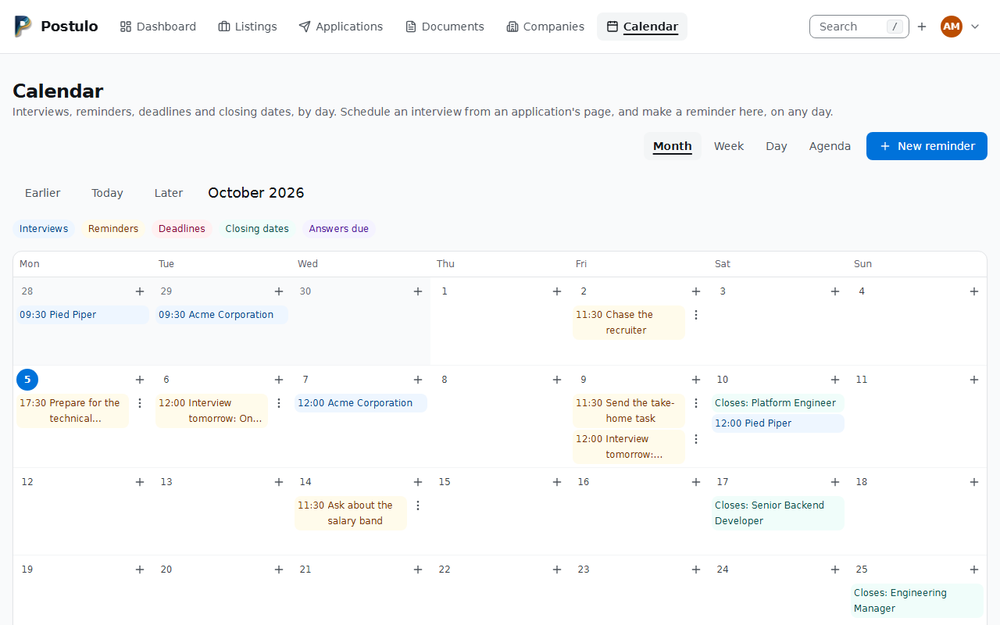
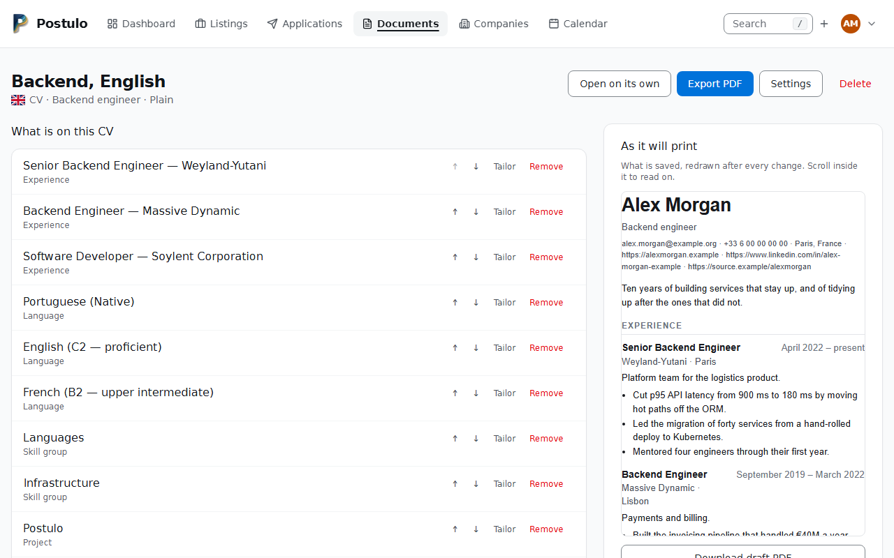

# Postulo

[](https://source.tiagoagueda.com/postulo/postulo/actions)
[](https://source.tiagoagueda.com/postulo/postulo/releases)
[](https://source.tiagoagueda.com/postulo/postulo/src/branch/main/LICENSE)
[](https://source.tiagoagueda.com/postulo/postulo/src/branch/main/pyproject.toml)
[](https://source.tiagoagueda.com/postulo/postulo/src/branch/main/pyproject.toml)
[](https://source.tiagoagueda.com/postulo/postulo/packages)
[](https://translate.tiagoagueda.com/projects/postulo/)
[](https://source.tiagoagueda.com/postulo/postulo/commits/branch/main)
[](https://source.tiagoagueda.com/postulo/postulo/src/branch/main/SECURITY.md)
[](https://source.tiagoagueda.com/postulo/postulo#never-paywalled)

**Self-hosted job application manager, from the applicant's side of the table.**

Every applicant tracking system is built for the company doing the hiring. Postulo is
built for the person applying: your applications, your CVs, your cover letters, your
data, on your server.

From the Latin *postulō* — "I apply for". First person, deliberately.

> **Status: pre-1.0.** Usable and used, but not battle-tested: it has recorded real
> applications, by one person, for weeks rather than years. Releasing here is a deliberate
> act rather than something that happens on a schedule, so `main` may be ahead of the last
> tag — the [changelog](CHANGELOG.md) says by how much.



| | |
| --- | --- |
|  |  |
|  |  |

*These pictures are of a demo instance filled with a fictional job search, and are retaken by
`scripts/screenshots.py` rather than by hand. There is no public demo to try: it would be
something to host, reset and secure, and nobody's data belongs on it. Run your own with
`manage.py seed_demo <email>`; the [wiki](https://source.tiagoagueda.com/postulo/postulo/wiki)
shows every page.*

## Never paywalled

**No feature of Postulo is, or ever will be, behind a paywall.** People looking for work
are, more often than not, people who cannot afford to pay for the tools to find it.
Everything this software does is available in full to everyone who runs it: no paid
tier, no "pro" edition, no licence key, no feature that unlocks later. The licence
guarantees that for the code; this paragraph guarantees it for the project's intentions.

### If it is worth something to you

**Voluntary support is this project's only income.** Not its main one — its only one.
There is no company behind Postulo, no funding round, no paid tier waiting to appear once
enough people depend on it. One person writes it, and what it costs to keep going comes
from people who decided it was worth something.

<a href="https://www.buymeacoffee.com/tiagoagueda"></a>

Nothing is owed. Nothing is unlocked by it, now or later — that is what the paragraph above
promises and it is not negotiable. And **nothing a person is shown while using Postulo to
look for work will ever ask for money**: no banner in the interface, no prompt, no reminder
on the dashboard. The one place inside the application that mentions support at all is
*Server settings → Overview*, the page addressed to whoever runs the instance, where it is
said once and in these words. Otherwise this is where the question is put, which is why it
is put plainly here.

If money is the wrong thing to give — and for a lot of people looking for work, it is —
then a bug report, a translation reviewed by somebody who actually speaks the language, or
telling one person who needs this that it exists are all worth as much.

[FUNDING.md](FUNDING.md) is the long version: what support pays for, what it will never
buy, and why money does not move an issue up the list.

## Secure, because of what it holds

**Postulo holds the most personal documents a person has while looking for work, and it
is built as if that were the only thing that mattered.** A CV carries a home address, a
phone number and a full employment history; a timeline says who has and has not replied.
So the code and the data are kept as secure as the project knows how to make them: every
record is owned and every query is scoped -- No one sees another person's data unless that person granted it -- explicitly, for a stated scope, revocably, and visibly to them at any time. Superusers can see and change any company, contact or listing, including private ones, but never anyone's notes, applications or documents. Files are never served without a permission
check, the browser is held to a strict content security policy, nothing is fetched from
the network without a deliberate decision, and the test suite includes security tests —
ownership sweeps, policy checks, the things an attacker would try — that fail the build.
Dependencies are checked for known vulnerabilities on every run and on a schedule, so a
fresh disclosure is noticed without anyone having to remember to look. A security report
is handled before any feature is; see [SECURITY.md](SECURITY.md).

## Built for everyone

**Postulo is meant to be usable by everyone, at its fullest, including people with
disabilities.** Looking for work is hard enough without the tool getting in the way. So
the interface is server-rendered HTML that works with scripts off, every control can be
reached and operated from the keyboard, images and icons carry names or are marked as
decorative, colour never carries a meaning on its own, changes on the page are announced
to screen readers, and the pages are checked against the accessibility guidelines
(WCAG 2.2, level AA) as part of the browser tests rather than as an afterthought. When a
feature cannot be made to work for someone, that is a bug, and it is filed as one.
[ACCESSIBILITY.md](ACCESSIBILITY.md) is the accessibility statement: what is checked and
how, what is known not to work yet, and how to report a barrier.

## What it does

- **Track applications** end to end — from a posting you spotted to an offer, with an
  append-only timeline that records what actually happened and when.
- **Manage CVs** as structured, reusable career content: write an experience once, then
  compose targeted CV variants from it without copy-pasting between documents.
- **Manage cover letters** from reusable templates with per-application placeholders.
- **Keep what you actually sent.** Every document is snapshotted to PDF at send time, so
  six months later you know exactly which version that employer read.
- **Bring your own files.** Externally authored PDFs and DOCX files are stored and
  versioned alongside generated ones.
- **Capture postings** from a URL — Postulo reads the page and asks you to confirm it
  before recording anything. Extensible through plugins, and reachable through a small
  API for scripts and browser extensions.
- **See what is working** — how far applications get, what share are answered, how long
  employers take, and which sources convert. Read from the timeline, so an interview that
  ended in a rejection still counts as an interview.
- **Take everything with you** — one zip holding a readable JSON document of every record
  and every file, which imports back.

## Principles

- **Your data is yours.** Full JSON + media export, always one command away.
- **No telemetry.** Outbound requests only for the features listed in the wiki's *Hardening* page.
- **Private by default.** Uploaded documents are never publicly served.
- **Secure by obligation.** Ownership-scoped queries, permission-checked files, a strict
  content security policy, security tests in the suite, and dependency vulnerability
  checks in CI. See [SECURITY.md](SECURITY.md).
- **Accessible to everyone.** Keyboard-operable, screen-reader-announced, usable with
  scripts off, and checked against WCAG 2.2 AA in the browser tests.
- **Boring, durable stack.** Django, SQLite or PostgreSQL, server-rendered HTML.
- **Modular by design.** Anything that could reasonably vary — where a posting is read
  from, how you are told about things, how a PDF is produced — sits behind an interface
  that a separately installed package can implement. Postulo's own implementations are
  plugins that happen to ship in the box. See [Writing a plugin](https://source.tiagoagueda.com/postulo/postulo/wiki/Writing-a-plugin).

## Written with AI, answered for by people

Much of Postulo is written with an AI assistant, and contributions made the same way are
welcome. The rule is simple: a person proposes the change, has read it, can explain it,
and answers for it. The assistant is a tool; the contributor is accountable. See
[CONTRIBUTING.md](CONTRIBUTING.md) and [AGENTS.md](AGENTS.md).

## In your language

The interface is a setting per person; the documentation is in English, and the table
below says what Postulo is in each language so nobody has to guess. Translations are made,
corrected and reviewed at [translate.tiagoagueda.com](https://translate.tiagoagueda.com/projects/postulo/)
([docs/TRANSLATING.md](docs/TRANSLATING.md)), where the live progress of every language is.

<!-- languages:start (written by scripts/readme_languages.py; do not edit by hand) -->

Postulo speaks **57 languages**, each named here as its speakers write it.

| | Language | What Postulo is |
| --- | --- | --- |
|  | **<span lang="az" dir="ltr">azərbaycan</span>** | <span lang="az" dir="ltr">Postulo öz serverinizdə yerləşdirilən iş müraciətləri meneceridir: müraciətləriniz, CV-ləriniz və müşayiət məktublarınız öz serverinizdə, heç bir ödənişli funksiya olmadan.</span> |
|  | **<span lang="id" dir="ltr">Bahasa Indonesia</span>** | <span lang="id" dir="ltr">Postulo adalah pengelola lamaran kerja yang dihosting sendiri: lamaran, CV, dan surat lamaran Anda di server Anda sendiri, tanpa fitur berbayar.</span> |
|  | **<span lang="bs" dir="ltr">bosanski</span>** | <span lang="bs" dir="ltr">Postulo je upravitelj prijava za posao koji hostujete sami: vaše prijave, CV-ovi i propratna pisma na vašem vlastitom serveru, bez plaćenih funkcija.</span> |
|  | **<span lang="ca" dir="ltr">català</span>** | <span lang="ca" dir="ltr">Postulo és un gestor de candidatures autoallotjat: les vostres candidatures, CV i cartes de presentació al vostre propi servidor, sense funcions de pagament.</span> |
|  | **<span lang="cnr" dir="ltr">crnogorski</span>** | <span lang="cnr" dir="ltr">Postulo je samostalno hostovan menadžer prijava za posao: vaše prijave, CV-jevi i propratna pisma na vašem sopstvenom serveru, bez plaćenih funkcija.</span> |
|  | **<span lang="cy" dir="ltr">Cymraeg</span>** | <span lang="cy" dir="ltr">Rheolwr ceisiadau am swyddi hunanletyol yw Postulo: eich ceisiadau, eich CVs a&#x27;ch llythyrau eglurhaol ar eich gweinydd eich hun, heb unrhyw nodweddion taledig.</span> |
|  | **<span lang="da" dir="ltr">dansk</span>** | <span lang="da" dir="ltr">Postulo er et selvhostet værktøj til at styre jobansøgninger: dine ansøgninger, CV&#x27;er og ansøgningsbreve på din egen server, uden betalingsfunktioner.</span> |
|  | **<span lang="de" dir="ltr">Deutsch</span>** | <span lang="de" dir="ltr">Postulo ist eine selbst gehostete Verwaltung für Bewerbungen: Ihre Bewerbungen, Lebensläufe und Anschreiben auf Ihrem eigenen Server, ohne kostenpflichtige Funktionen.</span> |
|  | **<span lang="et" dir="ltr">eesti</span>** | <span lang="et" dir="ltr">Postulo on isehostitav kandideerimiste haldur: teie kandideerimised, CV-d ja motivatsioonikirjad teie enda serveris, ilma tasuliste funktsioonideta.</span> |
|  | **<span lang="en-CA" dir="ltr">English (Canada)</span>** | <span lang="en-CA" dir="ltr">Postulo is a self-hosted job application manager: your applications, résumés and cover letters on your own server, with no paid features.</span> |
|  | **<span lang="en-GB" dir="ltr">English (United Kingdom)</span>** | <span lang="en-GB" dir="ltr">Postulo is a self-hosted job application manager: your applications, CVs and cover letters on your own server, with no paid features.</span> |
|  | **<span lang="es" dir="ltr">español</span>** | <span lang="es" dir="ltr">Postulo es un gestor de candidaturas de empleo autoalojado: sus candidaturas, CV y cartas de presentación en su propio servidor, sin funciones de pago.</span> |
|  | **<span lang="es-MX" dir="ltr">español (México)</span>** | <span lang="es-MX" dir="ltr">Postulo es un administrador de solicitudes de empleo de alojamiento propio: sus solicitudes, currículums y cartas de presentación en su propio servidor, sin funciones de pago.</span> |
|  | **<span lang="eu" dir="ltr">euskara</span>** | <span lang="eu" dir="ltr">Postulo norberaren zerbitzarian ostatatzen den hautagaitza-kudeatzaile bat da: zure hautagaitzak, CVak eta aurkezpen-gutunak zure zerbitzarian, ordainpeko funtziorik gabe.</span> |
|  | **<span lang="fr-CA" dir="ltr">français (Canada)</span>** | <span lang="fr-CA" dir="ltr">Postulo est un gestionnaire de candidatures auto-hébergé : vos candidatures, CV et lettres de présentation sur votre propre serveur, sans fonction payante.</span> |
|  | **<span lang="fr-FR" dir="ltr">français (France)</span>** | <span lang="fr-FR" dir="ltr">Postulo est un gestionnaire de candidatures auto-hébergé : vos candidatures, CV et lettres de motivation sur votre propre serveur, sans fonction payante.</span> |
|  | **<span lang="fo" dir="ltr">føroyskt</span>** | <span lang="fo" dir="ltr">Postulo er ein sjálvhýstur umsitari av starvsumsóknum: umsóknir tínar, lívsrásir og umsóknarbrøv á tínum egna ambætara, uttan nakrar eginleikar, sum skulu gjaldast fyri.</span> |
|  | **<span lang="ga" dir="ltr">Gaeilge</span>** | <span lang="ga" dir="ltr">Is bainisteoir iarratas poist féinóstáilte é Postulo: d’iarratais, do CVanna agus do litreacha cumhdaigh ar do fhreastalaí féin, gan aon ghnéithe íoctha.</span> |
|  | **<span lang="gl" dir="ltr">galego</span>** | <span lang="gl" dir="ltr">Postulo é un xestor de candidaturas de emprego autoaloxado: as túas candidaturas, CV e cartas de presentación no teu propio servidor, sen funcións de pago.</span> |
|  | **<span lang="hr" dir="ltr">hrvatski</span>** | <span lang="hr" dir="ltr">Postulo je samostalno hostiran upravitelj prijava za posao: vaše prijave, životopisi i popratna pisma na vašem vlastitom poslužitelju, bez plaćenih značajki.</span> |
|  | **<span lang="it" dir="ltr">italiano</span>** | <span lang="it" dir="ltr">Postulo è un gestore di candidature self-hosted: le tue candidature, i tuoi CV e le tue lettere di presentazione sul tuo server, senza funzioni a pagamento.</span> |
|  | **<span lang="lv" dir="ltr">latviešu</span>** | <span lang="lv" dir="ltr">Postulo ir savā serverī mitināts darba pieteikumu pārvaldnieks: jūsu pieteikumi, CV un pieteikuma vēstules jūsu pašu serverī, bez maksas funkcijām.</span> |
|  | **<span lang="lt" dir="ltr">lietuvių</span>** | <span lang="lt" dir="ltr">Postulo yra savarankiškai talpinama darbo paraiškų tvarkyklė: jūsų paraiškos, gyvenimo aprašymai ir motyvaciniai laiškai jūsų pačių serveryje, be mokamų funkcijų.</span> |
|  | **<span lang="lb" dir="ltr">Lëtzebuergesch</span>** | <span lang="lb" dir="ltr">Postulo ass e selwer gehosten Organisateur fir Kandidaturen: Är Kandidaturen, CVen a Motivatiounsbréiwer op Ärem eegene Server, ouni bezuelt Funktiounen.</span> |
|  | **<span lang="hu" dir="ltr">magyar</span>** | <span lang="hu" dir="ltr">A Postulo egy saját üzemeltetésű álláspályázat-kezelő: a jelentkezései, önéletrajzai és motivációs levelei a saját szerverén, fizetős funkciók nélkül.</span> |
|  | **<span lang="mt" dir="ltr">Malti</span>** | <span lang="mt" dir="ltr">Postulo huwa maniġer tal-applikazzjonijiet għax-xogħol li tospita int stess: l-applikazzjonijiet, is-CVs u l-ittri ta&#x27; akkumpanjament tiegħek fuq is-server tiegħek, mingħajr ebda funzjoni bi ħlas.</span> |
|  | **<span lang="nl" dir="ltr">Nederlands</span>** | <span lang="nl" dir="ltr">Postulo is een zelfgehost programma om sollicitaties te beheren: uw sollicitaties, cv’s en sollicitatiebrieven op uw eigen server, zonder betaalde functies.</span> |
|  | **<span lang="nb" dir="ltr">norsk bokmål</span>** | <span lang="nb" dir="ltr">Postulo er et selvhostet verktøy for jobbsøknader: søknadene, CV-ene og søknadsbrevene dine på din egen server, uten betalte funksjoner.</span> |
|  | **<span lang="nn" dir="ltr">norsk nynorsk</span>** | <span lang="nn" dir="ltr">Postulo er eit sjølvdrifta verktøy for jobbsøknader: søknadene, CV-ane og søknadsbreva dine på din eigen tenar, utan betalte funksjonar.</span> |
|  | **<span lang="pl" dir="ltr">polski</span>** | <span lang="pl" dir="ltr">Postulo to samodzielnie hostowany menedżer aplikacji o pracę: Twoje aplikacje, CV i listy motywacyjne na Twoim własnym serwerze, bez płatnych funkcji.</span> |
|  | **<span lang="pt-BR" dir="ltr">português (Brasil)</span>** | <span lang="pt-BR" dir="ltr">O Postulo é um gerenciador de candidaturas a vagas auto-hospedado: suas candidaturas, currículos e cartas de apresentação no seu próprio servidor, sem recursos pagos.</span> |
|  | **<span lang="pt-PT" dir="ltr">português (Portugal)</span>** | <span lang="pt-PT" dir="ltr">O Postulo é um gestor de candidaturas de emprego alojado por si: as suas candidaturas, CV e cartas de apresentação no seu próprio servidor, sem funcionalidades pagas.</span> |
|  | **<span lang="ro" dir="ltr">română</span>** | <span lang="ro" dir="ltr">Postulo este un manager de candidaturi auto-găzduit: candidaturile, CV-urile și scrisorile de intenție pe propriul dumneavoastră server, fără funcții plătite.</span> |
|  | **<span lang="rm" dir="ltr">rumantsch</span>** | <span lang="rm" dir="ltr">Postulo è in administratur da candidaturas ch&#x27;ins ospitescha sez: Vossas candidaturas, Voss CV e Vossas brevs d&#x27;accumpagnament sin Voss agen server, senza funcziuns a pajament.</span> |
|  | **<span lang="sq" dir="ltr">shqip</span>** | <span lang="sq" dir="ltr">Postulo është një menaxher aplikimesh për punë që e strehoni vetë: aplikimet, CV-të dhe letrat e motivimit tuaja në serverin tuaj, pa veçori me pagesë.</span> |
|  | **<span lang="sk" dir="ltr">slovenčina</span>** | <span lang="sk" dir="ltr">Postulo je správca žiadostí o miesto, ktorý si hostujete sami: vaše žiadosti, životopisy a motivačné listy na vašom vlastnom serveri, bez platených funkcií.</span> |
|  | **<span lang="sl" dir="ltr">slovenščina</span>** | <span lang="sl" dir="ltr">Postulo je samostojno gostovan upravitelj prijav na delovna mesta: vaše prijave, življenjepisi in spremna pisma na vašem lastnem strežniku, brez plačljivih funkcij.</span> |
|  | **<span lang="fi" dir="ltr">suomi</span>** | <span lang="fi" dir="ltr">Postulo on itse ylläpidettävä työhakemusten hallintasovellus: hakemuksesi, ansioluettelosi ja saatekirjeesi omalla palvelimellasi, ilman maksullisia ominaisuuksia.</span> |
|  | **<span lang="sv" dir="ltr">svenska</span>** | <span lang="sv" dir="ltr">Postulo är en självhostad hanterare för jobbansökningar: dina ansökningar, CV:n och personliga brev på din egen server, utan betalfunktioner.</span> |
|  | **<span lang="tr" dir="ltr">Türkçe</span>** | <span lang="tr" dir="ltr">Postulo kendi sunucunuzda barındırılan bir iş başvurusu yöneticisidir: başvurularınız, CV&#x27;leriniz ve ön yazılarınız kendi sunucunuzda; ücretli özellik yok.</span> |
|  | **<span lang="is" dir="ltr">íslenska</span>** | <span lang="is" dir="ltr">Postulo er sjálfhýst kerfi til að halda utan um atvinnuumsóknir: umsóknirnar þínar, ferilskrár og kynningarbréf á þínum eigin netþjóni, án nokkurra greiddra eiginleika.</span> |
|  | **<span lang="cs" dir="ltr">čeština</span>** | <span lang="cs" dir="ltr">Postulo je správce žádostí o místo, který si hostujete sami: vaše žádosti, životopisy a motivační dopisy na vašem vlastním serveru, bez placených funkcí.</span> |
|  | **<span lang="el" dir="ltr">Ελληνικά</span>** | <span lang="el" dir="ltr">Το Postulo είναι ένα αυτοφιλοξενούμενο εργαλείο διαχείρισης αιτήσεων εργασίας: οι αιτήσεις, τα βιογραφικά και οι συνοδευτικές επιστολές σας στον δικό σας διακομιστή, χωρίς επί πληρωμή λειτουργίες.</span> |
|  | **<span lang="be" dir="ltr">беларуская</span>** | <span lang="be" dir="ltr">Postulo — менеджар заявак на працу для самастойнага размяшчэння: вашы заяўкі, рэзюмэ і суправаджальныя лісты на вашым уласным серверы, без платных функцый.</span> |
|  | **<span lang="bg" dir="ltr">български</span>** | <span lang="bg" dir="ltr">Postulo е самостоятелно хостван инструмент за управление на кандидатури за работа: вашите кандидатури, автобиографии и мотивационни писма на собствения ви сървър, без платени функции.</span> |
|  | **<span lang="mk" dir="ltr">македонски</span>** | <span lang="mk" dir="ltr">Postulo е самостојно хостиран менаџер за пријави за работа: вашите пријави, CV и мотивациски писма на вашиот сопствен сервер, без платени функции.</span> |
|  | **<span lang="sr-Cyrl" dir="ltr">српски</span>** | <span lang="sr-Cyrl" dir="ltr">Postulo је менаџер пријава за посао који сами хостујете: ваше пријаве, CV-ови и пропратна писма на вашем сопственом серверу, без плаћених функција.</span> |
|  | **<span lang="uk" dir="ltr">українська</span>** | <span lang="uk" dir="ltr">Postulo — це самостійно розміщуваний менеджер заявок на роботу: ваші заявки, резюме й супровідні листи на вашому власному сервері, без платних функцій.</span> |
|  | **<span lang="kk" dir="ltr">қазақ тілі</span>** | <span lang="kk" dir="ltr">Postulo — өз серверіңізде орнатылатын жұмыс өтінімдерін басқару құралы: өтінімдеріңіз, түйіндемелеріңіз және ілеспе хаттарыңыз өз серверіңізде, ақылы мүмкіндіктерсіз.</span> |
|  | **<span lang="hy" dir="ltr">հայերեն</span>** | <span lang="hy" dir="ltr">Postulo-ն աշխատանքի դիմումների կառավարիչ է, որը տեղակայում եք ինքներդ․ ձեր դիմումները, CV-ները և մոտիվացիոն նամակները՝ ձեր սեփական սերվերում, առանց վճարովի գործառույթների։</span> |
|  | **<span lang="ur" dir="rtl">اردو</span>** | <span lang="ur" dir="rtl">Postulo ایک سیلف ہوسٹڈ ملازمت کی درخواستوں کا منیجر ہے: آپ کی درخواستیں، CV اور کور لیٹر آپ کے اپنے سرور پر، بغیر کسی ادائیگی والی خصوصیت کے۔</span> |
|  | **<span lang="ar" dir="rtl">العربية</span>** | <span lang="ar" dir="rtl">Postulo مدير لطلبات التوظيف تستضيفه بنفسك: طلباتك وسيرك الذاتية وخطابات التقديم على خادمك الخاص، دون ميزات مدفوعة.</span> |
|  | **<span lang="hi" dir="ltr">हिन्दी</span>** | <span lang="hi" dir="ltr">Postulo एक सेल्फ़-होस्टेड नौकरी आवेदन मैनेजर है: आपके आवेदन, CV और कवर लेटर आपके अपने सर्वर पर, बिना किसी पेड फ़ीचर के।</span> |
|  | **<span lang="bn" dir="ltr">বাংলা</span>** | <span lang="bn" dir="ltr">Postulo একটি স্ব-হোস্টেড চাকরির আবেদন ব্যবস্থাপক: আপনার আবেদন, সিভি ও কভার লেটার আপনার নিজের সার্ভারে, কোনো পেইড ফিচার ছাড়াই।</span> |
|  | **<span lang="ka" dir="ltr">ქართული</span>** | <span lang="ka" dir="ltr">Postulo არის საკუთარ სერვერზე განსათავსებელი სამუშაო განაცხადების მართვის პროგრამა: თქვენი განაცხადები, CV-ები და თანმხლები წერილები თქვენს საკუთარ სერვერზე, ფასიანი ფუნქციების გარეშე.</span> |
|  | **<span lang="zh-Hans" dir="ltr">简体中文</span>** | <span lang="zh-Hans" dir="ltr">Postulo 是一款自托管的求职申请管理工具：你的申请、简历和求职信都保存在你自己的服务器上，没有任何付费功能。</span> |
|  | **<span lang="zh-Hant" dir="ltr">繁體中文</span>** | <span lang="zh-Hant" dir="ltr">Postulo 是自行架設的求職應徵管理工具：您的應徵、履歷和求職信都在您自己的伺服器上，沒有任何付費功能。</span> |

<!-- languages:end -->

## Documentation

- **[The wiki](https://source.tiagoagueda.com/postulo/postulo/wiki)** — installing,
  configuring and using Postulo. Its pages are their own repository,
  [postulo.wiki](https://source.tiagoagueda.com/postulo/postulo.wiki).
- [Implementation plan](docs/PLAN.md) — architecture, data model, and milestones
- [Writing a plugin](https://source.tiagoagueda.com/postulo/postulo/wiki/Writing-a-plugin) — the plugin contract, and every name a plugin may import

## Running it

```sh
git clone https://source.tiagoagueda.com/postulo/postulo.git
cd postulo
git checkout vX.Y.Z           # the latest release tag, see the releases page
cp .env.example .env          # set POSTULO_SECRET_KEY and POSTULO_ALLOWED_HOSTS
docker compose -f docker/compose.yml up -d
docker compose -f docker/compose.yml exec postulo python manage.py createsuperuser
```

That pulls the published image. To build it from the checkout instead, add the build
override: `docker compose -f docker/compose.yml -f docker/compose.build.yml up -d --build`.

Then put a reverse proxy in front of it for TLS. See
[Installing Postulo](https://source.tiagoagueda.com/postulo/postulo/wiki/Installing-Postulo)
for the full instructions, including installing without a container.

## Development

Requires Python 3.12.4 or newer and [uv](https://docs.astral.sh/uv/).

```sh
uv sync                      # install dependencies
cp .env.example .env         # configure (a dev SECRET_KEY is generated if unset)
uv run manage.py migrate
uv run manage.py createsuperuser
uv run manage.py runserver
```

PDF export uses **WeasyPrint**, which is installed with Postulo. On Linux it needs
Pango:

```sh
sudo apt install libpango-1.0-0 libpangoft2-1.0-0 libharfbuzz-subset0     # Debian and Ubuntu
```

Those libraries are awkward to obtain on Windows, so a fallback renderer exists there:

```sh
uv sync --extra chromium
uv run playwright install chromium
```

Postulo uses whichever works, preferring WeasyPrint. Export is optional: tracking
applications and writing letters need no renderer at all.

Node is **not** required to run Postulo: the compiled stylesheet is committed. It is
only needed to change the CSS, or to add a Tailwind class a template did not use before,
in which case:

```sh
npm install
npm run watch:css            # or `npm run build:css` for a one-off
```

To see it with data rather than an empty screen, fill an account with a fictional
search — thirty applications over six months, with documents:

```sh
uv run manage.py seed_demo you@example.org
```

Tests and linting:

```sh
uv run pytest
uv run ruff check .
uv run ruff format .
```

## Licence

Copyright (C) 2026 Postulo contributors. [AGPL-3.0-or-later](LICENSE). If you run a modified
Postulo as a network service, your users are entitled to its source.

Some of what ships in the repository is somebody else's work under a licence of its own:
the [Lucide](https://lucide.dev) icons, the [flag-icons](https://github.com/lipis/flag-icons)
country flags, Tailwind CSS and basecoat-css compiled into the stylesheet, htmx and zxcvbn
served as scripts. All of it is copied into the repository, so nothing is fetched from
anybody else's server at runtime, and each carries its notice beside it.
[THIRD-PARTY.md](THIRD-PARTY.md) is the register.

The **name and the logo** are not covered by that licence. [TRADEMARKS.md](TRADEMARKS.md)
says what you may do without asking — which is nearly everything, including naming a plugin
`postulo-something` and calling your instance whatever you like — and the one case where a
fork should use another name. It also names the marks belonging to other people that appear
here, and none of their owners is involved with this project.

## Where this lives

Developed on [Forgejo](https://source.tiagoagueda.com/postulo/postulo) and mirrored to
GitHub. Issues and pull requests belong on the Forgejo repository; the GitHub copy is a
read-only mirror. A bug or a request has a form there (see
[CONTRIBUTING.md](CONTRIBUTING.md#opening-an-issue)); a security problem does not go in an
issue, see [SECURITY.md](SECURITY.md). Everyone taking part is held to the
[code of conduct](CODE_OF_CONDUCT.md).
